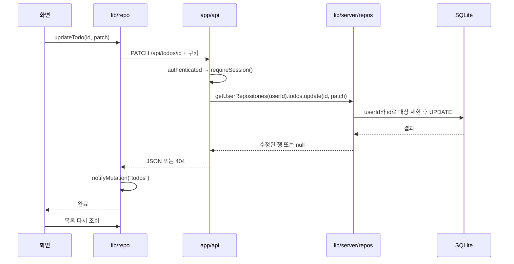

# 구조와 공통 구현

[문서 목차](README.md) · [데이터 모델](02-data-model.md) · [API](03-api.md)

## 1. 기술과 실행 환경

| 계층 | 사용 기술 | 역할 |
|---|---|---|
| 웹 프레임워크 | Next.js 16.2.4 App Router | URL, 레이아웃, API, 서버 빌드 |
| UI | React 19.2.4 + TypeScript | 화면 상태와 입력 이벤트 |
| 스타일 | Tailwind CSS 4, lucide-react | 반응형 레이아웃, 테마, 아이콘 |
| 움직임 | motion/react | 루틴 목록 드래그 정렬 |
| 공통 상태 | Zustand | 로그인 사용자, 목표, 카테고리, 설정 |
| 날짜 | date-fns 4 | ISO 주차, 달력 범위, 날짜 표시 |
| 저장 | better-sqlite3 + Drizzle ORM | SQLite 파일 접근, 스키마, SQL |
| 인증 | iron-session, argon2 | 암호화 세션 쿠키, 비밀번호 검증 |
| 식별자 | ULID | 사용자와 도메인 레코드 ID |
| 검증 | Vitest, Playwright | 단위 테스트와 브라우저 시나리오 |
| 배포 | Docker Compose, Caddy | 앱 프로세스, DB 볼륨, HTTPS 프록시 |

버전 기준은 [package.json](../package.json)입니다. 범위 버전의 설치 결과는 `package-lock.json`에서 확인합니다. SQLite와 argon2는 네이티브 모듈이라 Node 서버 런타임이 필요합니다.

## 2. 디렉터리별 역할

```text
app/
  layout.tsx                HTML, 메타데이터, 폰트, 전역 CSS
  page.tsx                  /daily로 이동; 브라우저가 오늘 일일 날짜 선택
  login/                    로그인 화면
  (app)/                    로그인 이후 공통 레이아웃과 페이지
  api/                      도메인별 HTTP 요청 핸들러
components/
  annual/ daily/ mandalart/ monthly/ week/ retro/ reading/ settings/
  common/                   TODO·목표 선택·한 문장 편집
  nav/                      데스크톱 상단·모바일 하단 메뉴
  providers/                초기 로딩, 테마 적용
store/index.ts              실제 API와 Zustand 저장소 연결
store/createBinderStore.ts  의존성 주입, 초기화 공유·실패 재시도·조회 순서 제어
lib/
  types.ts                  공통 도메인 타입
  backup.ts                 백업 컬렉션·가져오기 결과 계약
  validation/               DB·HTTP에 의존하지 않는 입력 규칙
  time-grid/                시간표 좌표 계산과 이동·복사 정책
  client/                   HttpClient, AsyncResource
  hooks/                    조회 구독·최신 콜백·localStorage 상태
  repo/                     브라우저 API와 리소스별 변경 알림
  progress/types.ts         클라이언트·서버 공용 진행률 계약
  server/auth.ts            세션 읽기와 비밀번호 검증
  server/http.ts            authenticated 인증 경계
  server/db/                DatabaseConnection, 사용자 초기화, 스키마, PATCH 유틸
  server/backup/            BackupService와 사용자별 백업 repository
  server/repos/             11개 저장소 클래스, UserRepositories 조립
  server/progress.ts        목표 진행률 계산
  aggregate.ts              시간블록 분 단위 합산
  mandalart.ts              9×9 보드 배치
  utils/                    날짜·기간 키·습관 일정·색·상태
drizzle/                    SQL 마이그레이션과 메타데이터
scripts/                    계정 관리, 해시 생성, HTML 변환
tests/                      단위 테스트, E2E, 보조 코드
public/                     SVG, 기존 seed JSON
docs/                       이 문서 묶음
```

`data/`, `backups/`, `.next/`, `test-results/`, `tmp-test/`, `.worktrees/`는 데이터·생성물·별도 작업용 경로입니다. 앱 기능 코드와 구분합니다.

## 3. 라우팅과 렌더링

`app/(app)`의 괄호는 URL에 나타나지 않습니다. 공통 메뉴와 `StoreProvider`를 적용하는 라우트 그룹입니다. 페이지 파일은 주로 URL 파라미터를 실제 화면 컴포넌트에 전달합니다.

동적 페이지와 API의 `params`는 `Promise`이며 `await params` 또는 `await ctx.params`로 읽습니다. `/`는 서버에서 `/daily`로 이동하고, `/daily`의 클라이언트 effect가 브라우저 날짜로 `/daily/YYYY-MM-DD`를 선택합니다. 날짜가 빌드 시점이나 서버 시간대로 고정되지 않습니다.

대부분의 페이지 래퍼·레이아웃은 서버 컴포넌트이고, `/daily` 진입 페이지는 클라이언트 컴포넌트입니다. 실제 편집 화면 상당수는 `'use client'` 컴포넌트입니다. 클라이언트 컴포넌트도 초기 HTML 생성에 관여할 수 있습니다. 도메인 데이터는 주로 마운트 후 effect에서 API를 호출해 가져옵니다.

관련 로컬 Next.js 가이드는 `node_modules/next/dist/docs/01-app/01-getting-started/03-layouts-and-pages.md`, `15-route-handlers.md`입니다. 개발 규칙은 [AGENTS.md](../AGENTS.md)를 따릅니다.

## 4. 한 번의 저장이 지나가는 경로



`lib/repo/todos.ts`는 fetch를, `lib/server/repos/todos.ts`는 SQL을 담당합니다. 같은 도메인의 브라우저·서버 역할을 나눠 파일명이 같습니다.

## 5. 공통 상태와 새로고침

[createBinderStore](../store/createBinderStore.ts)의 `init()`은 사용자 정보, 카테고리, 목표, 설정을 병렬 로딩하고 모두 성공하면 `ready=true`로 바꿉니다. 중복 초기화는 진행 중인 Promise를 공유합니다. [StoreProvider](../components/providers/StoreProvider.tsx)는 로딩 중 표시와 실패 시 재시도 버튼을 제공합니다. `reload()`는 사용자 정보를 제외한 공통 데이터를 갱신하며 이전 요청이 나중 결과를 덮어쓰지 못하게 합니다.

TODO, 책, 습관 로그, 일일 시간블록 등의 조회 상태는 [useAsyncResource](../lib/hooks/useAsyncResource.ts)가 관리합니다. 사용자와 조회 키가 바뀌면 별도 상태를 사용하고 오래된 응답·해제된 구독의 응답을 무시합니다. 전역 캐시가 아니라 각 화면 인스턴스의 리소스이며 읽기 실패 시 마지막 값을 보존합니다. 주간 화면의 시간블록·일별 TODO는 `WeeklyDataProvider`가 공통으로 조회하고 `WeeklyViews`가 현재 너비에 맞는 뷰만 실행합니다. 전역 저장소에 모든 DB 데이터가 들어 있지는 않습니다.

[events.ts](../lib/repo/events.ts)의 `onDirty()`와 `notifyMutation()`는 현재 브라우저 실행 컨텍스트 안의 구독 시스템입니다. 모든 컴포넌트가 구독하지 않으며 서버 푸시나 다른 탭·기기와의 실시간 동기화는 없습니다. 화면마다 직접 재조회하거나 알림을 구독합니다. 모든 도메인 변경은 리소스 이름을 전달하며 구독한 목록만 재조회합니다. 가져오기 성공 시 관련 리소스에 알리고 공통 store를 reload합니다. UI 접힘 설정은 `useStoredBoolean`이 localStorage와 같은 문서/다른 탭의 storage 이벤트를 구독합니다.

## 6. 저장과 편집의 공통 규칙

| UI | 저장 시점 |
|---|---|
| 목표 보드·시간블록 모달 | 저장 버튼 또는 Enter |
| 새 TODO | TodoCreateInput의 Enter 또는 포커스 이탈; 요청 중복 방지, 한글 조합 Enter 제외 |
| 기존 TODO 제목 | 편집 진입 후 Enter 또는 포커스 이탈 |
| 연간 목표·책 목록 텍스트 | 포커스 이탈(`onBlur`) |
| TODO 상태·카테고리 선택·목표 연결 선택 | 변경 이벤트 직후 |
| 설정의 카테고리 이름·색 편집 | 포커스 이탈 |
| 한 문장·일일 메모·독서·회고 | 약 1초 후; 닫기·이동 때 보류 저장 요청, 순차 큐와 초안 복구 |
| 루틴 순서 | 마지막 정렬 이벤트에서 약 350ms 후; 닫힐 때 보류분 저장 시도 |
| 습관 체크 | 클릭 시 서버 토글 요청 |

`TodoTitleEditor`는 1회 클릭으로 선택하고 더블클릭·연속 탭·Enter·F2·연필 버튼으로 편집합니다. Escape는 편집을 취소하며 빈 제목이나 기존과 같은 제목은 저장하지 않습니다. `TodoStatusButton`은 다섯 상태를 직접 고르는 메뉴를 열고 Escape·스크롤·바깥 클릭으로 닫습니다.

연결 해제에는 `{ categoryId: null }`처럼 `null`을 사용합니다. `undefined`는 JSON에서 빠지므로 변경 없음입니다. [http.ts](../lib/repo/http.ts)와 [patch.ts](../lib/server/db/patch.ts)가 이 규칙을 설명합니다.

## 7. 표시와 테마

전역 스타일은 [globals.css](../app/globals.css), 테마 적용은 [ThemeApplier](../components/providers/ThemeApplier.tsx)에 있습니다. 저장된 테마를 `<html data-theme>`에 반영합니다. 기본은 light이며 로그인 화면은 앱의 StoreProvider 밖에 있습니다.

메뉴 전환은 `lg`, 주간 그리드와 모바일 목록 전환은 `md` 기준입니다. 태블릿에서 시간표는 보이지만 메뉴는 하단일 수 있습니다. 모바일 화면이 데스크톱의 모든 편집 필드를 제공하는 것은 아닙니다.

[manifest.ts](../app/manifest.ts)는 이름·아이콘·standalone 표시를 정의합니다. 현재 소스에는 오프라인 캐시를 제공하는 서비스 워커 구현이 없습니다.

## 8. 현재 화면에 연결되지 않은 코드

`components/annual/CoreSection.tsx`와 `SubCard.tsx`, `components/daily/DailyMemo.tsx`, `components/week/HabitStrip.tsx`는 남아 있지만 현재 주요 페이지에서 렌더링하지 않습니다. `lib/repo/syncMeta.ts`는 아무 작업도 하지 않는 호환용 코드이고 클라이언트 `syncAnnualGoalFromHabits()`도 집계하지 않습니다. 실제 집계는 서버 습관 repository에 있습니다.

타입·컴포넌트 존재만으로 현재 화면 기능이라고 판단하지 말고 페이지의 import와 렌더링 경로를 확인합니다.

## 9. 책임을 분리한 객체

- DatabaseConnection은 연결·마이그레이션·초기화 성공 여부·close를 관리합니다.
- BackupService는 검증·트랜잭션·집계 순서를, UserBackupRepository는 계정별 SQL을 담당합니다.
- UserRepositories가 DB와 사용자 ID로 11개 도메인 저장소를 조립합니다. 각 저장소가 SQL과 소유권 조건을 보유하며 SettingsRepository는 기본값과 원자적 설정 갱신을 담당합니다.
- GoalProgressService는 주입받은 DB와 기준 날짜로 목표 진행률을 계산합니다.
- HttpClient는 전송·오류·인증 만료 처리를, AsyncResource는 조회 상태·최신 응답 반영을 담당합니다.
- TimeGridGeometry는 좌표 계산, TimeBlockCommands는 주입받은 저장 인터페이스로 이동·복사를 수행합니다.
- TodoCreateInput은 입력 이벤트와 중복 제출 방지를 한곳에서 처리합니다.
- useTimeGridInteraction, useBlockEditor, useDailyTracker, useHabitEditor, useAnnualGoals는 동작과 조회를 맡고 대응 컴포넌트는 화면을 렌더링합니다.

기존 도메인 repository 함수는 호환 진입점으로 유지합니다. 구체적인 의존성 주입 예와 기능별 변경 순서는 [유지보수 가이드](06-maintenance.md)에 있습니다.
