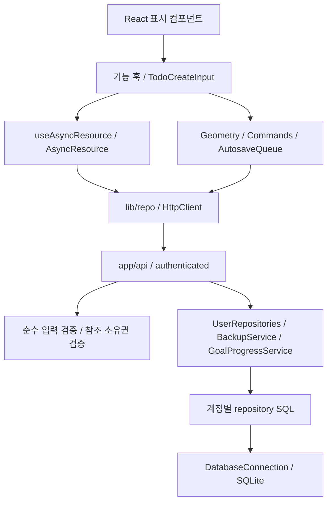

# 유지보수와 기능 확장 가이드

[전체 목차](README.md) · [구조](01-architecture.md) · [전체 리팩토링 기록](08-full-refactor.md)

이 문서는 2026-10-29 책임 분리 이후의 변경 위치와 검증 방법을 설명합니다. 서버의 11개 저장소는 DB와 사용자 ID를 주입받는 객체입니다. 기존 함수형 API는 호환용으로 유지하고 새 호출은 UserRepositories를 사용합니다. 화면은 기능별 훅과 표시 컴포넌트로 나누고, 조회·전송·저장 큐를 공통화했습니다.

## 1. 책임과 의존성



| 코드 | 책임 | 변경할 때 지킬 조건 |
|---|---|---|
| [DatabaseConnection](../lib/server/db/connection.ts) | 연결·마이그레이션·초기화·종료 | 초기화 성공 후에만 연결을 공개하고 실패 시 닫기 |
| [bootstrap](../lib/server/db/bootstrap.ts) | 최초 사용자·기본 카테고리·기존 데이터 소유자 설정 | 주입받은 트랜잭션만 사용 |
| [BackupService](../lib/server/backup/service.ts) | 가져오기 전체 순서와 트랜잭션 | 검증·replace 삭제·삽입·집계를 한 즉시 트랜잭션으로 실행 |
| [UserBackupRepository](../lib/server/backup/repository.ts) | 백업 SQL과 소유권 조회 | 생성자의 userId로 데이터 범위를 제한 |
| [UserRepositories](../lib/server/repos/index.ts) | 같은 DB·사용자 기준으로 11개 저장소 조립 | 요청마다 인증된 userId 사용, 다른 계정 객체 재사용 금지 |
| [authenticated](../lib/server/http.ts) | 세션 조회와 인증 Response 처리 | DB·설정 오류를 401로 숨기지 않기 |
| [GoalProgressService](../lib/server/progress.ts) | 기준 날짜의 목표별 집계 | 직접 연결·실제 시간 기준 유지 |
| [HttpClient](../lib/client/HttpClient.ts) | JSON 전송·오류·인증 만료 처리 | null·undefined·204 계약 유지 |
| [AsyncResource](../lib/client/AsyncResource.ts) | 조회 상태·알림·최신 응답 관리 | key 변경·해제·낙관적 수정 뒤 이전 응답 무시 |
| [createBinderStore](../store/createBinderStore.ts) | 공통 데이터 초기화·재조회 | 초기화 공유, 부분 성공 미반영, 실패 재시도 |
| [SettingsRepository](../lib/server/repos/settings.ts) | 기본값·조회·부분 갱신 | 현재 값과 합친 시간 범위를 잠금 안에서 검증 |
| [순수 검증](../lib/validation/mutations.ts) | 필드·날짜·enum·관계 규칙 | HTTP·DB 의존성을 추가하지 않기 |
| [서버 검증](../lib/server/validation.ts) | 요청 JSON·참조 소유권·부분 변경 검증 | 인증된 사용자 기준으로 참조 확인 |
| [TimeGridGeometry](../lib/time-grid/geometry.ts) | 행·분·범위·배치 계산 | DOM·API 없이 입력과 결과로 테스트 |
| [TimeBlockCommands](../lib/time-grid/commands.ts) | 시간블록 이동·복사 정책 | 주입한 writer로 저장, 다른 날짜 복사 시 todoId 제외 |

객체는 생성자로 의존성을 받습니다. 예를 들어 `new UserRepositories(testDb, userId)`로 운영 연결 없이 저장소를 검사하고, `new BackupService(getDb, () => fixedDate)`로 시간을 고정하거나 `new TimeBlockCommands(fakeWriter)`로 저장 결과를 확인할 수 있습니다. 상속 계층이나 범용 BaseRepository를 추가할 필요는 없습니다. React 렌더링은 함수 컴포넌트, 날짜·집계 계산은 순수 함수로 유지합니다.

## 2. TODO 입력을 바꿀 때

공통 [TodoCreateInput](../components/common/TodoCreateInput.tsx)에 `onCreate(title, requestKey)`와 `onDone()`을 전달합니다. 월/주/일의 scope, scopeKey, order는 호출부가 정하고, 입력 컴포넌트가 저장 잠금·한글 조합·취소·실패 표시를 관리합니다.

- Enter와 blur는 같은 제출 경로를 사용합니다. 비동기 요청 전에 ref를 잠가 같은 틱의 중복 이벤트도 막습니다.
- 한글 조합 중 Enter, keyCode 229, 키를 누르고 있을 때의 반복 이벤트는 제출하지 않습니다.
- 실패하면 입력을 유지하고 재시도할 수 있습니다. 성공하거나 Escape로 취소한 입력 세션은 다시 제출하지 않습니다.
- 같은 제목의 별도 TODO 작성은 허용합니다. 제목 기반 중복 제거를 추가하지 마세요.
- 다른 날짜로 바뀌는 입력에는 scope/date 기반 `key`를 사용합니다. 네트워크 응답 유실 후 같은 초안을 재시도할 때 최초 UUID와 본문을 유지합니다. 서버의 사용자+요청 키 기록이 재생성을 막습니다.

회귀 테스트는 [todo-create 단위 테스트](../tests/unit/todo-create.test.tsx)와 [브라우저 테스트](../tests/e2e/todo-create.spec.ts)입니다. 세 입력 경로, 한글 조합, 지연 응답, 실패·재시도, 월간 우선순위 해제를 확인합니다.

## 3. 저장 필드나 API를 추가할 때

1. [도메인 타입](../lib/types.ts), [DB 스키마](../lib/server/db/schema.ts), 순수 입력 규칙을 함께 수정합니다.
2. `npx drizzle-kit generate`로 SQL을 생성하고 기존 데이터 변환과 기본값을 검토합니다. 생성 SQL을 테스트 DB에 실제 적용합니다.
3. 해당 서버 repository 클래스에 동작을 추가하고 모든 조회·변경에 사용자 조건을 유지합니다. 다른 사용자의 참조 ID를 받지 않도록 서버 검증도 연결합니다.
4. API는 `authenticated(async (session, req, ctx) => ...)`로 감싸고 `getUserRepositories(session.userId)`를 사용합니다. 파싱·상태코드는 API, 업무 처리와 트랜잭션은 서비스/repository에 둡니다. 기존 함수형 진입점은 호환성을 유지합니다.
5. 브라우저 repository의 반환 타입·변경 알림·화면 재조회와 자동 저장을 확인합니다. PATCH의 `null`은 해제, 키 생략은 유지입니다.
6. 새 컬렉션이면 [백업 계약](../lib/backup.ts), 백업 테이블 매핑·조회·삭제 순서, [import 검증](../lib/server/importValidation.ts), 백업 왕복 테스트도 갱신합니다.
7. [데이터 모델](02-data-model.md), [API 명세](03-api.md), 해당 페이지 문서와 검증 기록을 함께 고칩니다.

백업 `replace`는 기존 사용자 데이터를 바꾸므로 검증을 트랜잭션 밖으로 옮기지 않습니다. 잘못된 참조나 중간 SQL 실패 시 기존 데이터가 보존되는지 테스트합니다. version 값만 올려도 예전 백업이 자동 변환되지는 않습니다.

## 4. 시간표를 바꿀 때

TimeGrid는 표시와 편집기 배치를 담당하고 `useTimeGridInteraction`이 포인터·드래그 세션·Escape 취소를 처리합니다. 시간→행 계산은 Geometry, 이동/복사 payload는 Commands에서 수정합니다. `useBlockEditor`는 폼 값·키보드·저장/삭제 잠금을 관리합니다. React state updater 내부에서 ref를 읽거나 변경하지 말고 이벤트 핸들러에서 다음 상태를 계산해 반영합니다.

다음 날짜 복사는 TODO 연결을 제외하지만 목표·카테고리는 유지합니다. 이동은 기존 연결을 유지합니다. 이 정책을 변경하면 [time-grid 단위 테스트](../tests/unit/time-grid.test.ts), 일일·주간 드래그 E2E와 문서를 함께 바꿉니다. 수정 없는 이동은 API 요청을 만들지 않습니다.

## 5. 화면 조회·동작을 바꿀 때

- `useAsyncResource(key, loader, initial, resources)`의 key에는 조회 날짜·기간·대상 ID를 포함합니다. 사용자 ID는 훅이 붙입니다. loader는 조회만 수행해야 하며 변경 알림을 발생시키는 API를 호출하면 재조회 루프가 생길 수 있습니다.
- 변경 알림은 `todos`, `habits`, `books`처럼 실제 리소스 이름을 전달합니다. 서로 다른 화면 인스턴스의 조회를 전역으로 합치는 캐시는 아니며, 주간 범위 공유는 기존 WeeklyDataProvider를 사용합니다.
- 날짜·대상 전환 시 입력 세션도 바뀌어야 하면 상위에서 `key`를 지정합니다. 렌더 중 ref 쓰기는 피하고 최신 저장 콜백에는 `useLatest`를 사용합니다.
- `useDailyTracker`는 루틴 조회·그룹·체크·프리셋, `useHabitEditor`는 일정 편집·순서 저장, `useAnnualGoals`는 연간 데이터·수치 변경을 담당합니다. 화면 배치 수정은 각각 DailyPage/HabitRow, AnnualGoalDesktop/AnnualGoalMobile에서 합니다.
- 루틴 정렬은 AutosaveQueue의 350ms 지연을 사용합니다. 보류값을 덮어쓸 수 있어야 하며 닫기 시 flush와 실패 재시도를 보존합니다.
- 가져오기는 `lib/repo/backup.ts`를 사용해 리소스 변경을 알리고 공통 store를 reload합니다. 서버 저장 성공과 후속 조회 실패를 서로 구분해 표시합니다.

## 6. 검증과 안전한 작업 순서

```powershell
npm run typecheck
npm run lint -- --max-warnings 0
npm test -- --maxWorkers=4
npm run e2e -- --workers=2
npm run docs:check
npm run build
```

변경 범위에 맞는 검사를 먼저 실행하고, 빌드는 E2E 개발 서버가 종료된 뒤 실행합니다. 두 작업은 기본 `.next` 경로를 공유합니다. 전체 lint는 오류·경고 0개를 유지합니다. 현재 검증 결과는 [전체 리팩토링 기록](08-full-refactor.md)에 있습니다. 검사 실패를 규칙 비활성화로 숨기지 않습니다.

운영 DB와 분리한 환경을 사용합니다. E2E는 3100과 `tmp-test/e2e.sqlite`, 수동 개발은 3101과 별도 DB를 사용합니다. 이미 켜진 3100 서버를 재사용하면 그 서버의 DB 설정도 확인합니다. `docs:check`는 Markdown 상대 파일 링크만 확인하며, 문장 정확성·앵커·외부 URL 검사는 대신하지 않습니다.

작업 전 기존 미커밋 변경을 확인하고 보존합니다. 소스 검증과 Docker 배포는 구분해 기록하며, 운영 반영은 [개발·운영 절차](04-development-and-operations.md)를 따릅니다.

## 추가 기능 변경 위치

- TODO 원자적 생성·삭제·복원·이월은 [TodoActions](../lib/server/todos/actions.ts)가 DB·사용자·시계를 주입받습니다. 새 UI도 같은 요청 키를 `createTodo`에 전달하세요.
- 검색은 [SearchRepository](../lib/server/search/repository.ts)의 사용자 조건을 모든 UNION 분기에서 유지합니다. 도메인 추가 시 공유 타입·화면 필터·목적지·소유권 테스트를 함께 수정하세요.
- 자동 백업은 [SqliteBackup](../scripts/lib/sqlite-backup.mjs)가 온라인 백업·복원 검사·보관 정책을 맡고 scheduler는 실행 시각과 상태만 관리합니다. 검증 이전 보관 정리를 금지하며 수동 백업을 삭제하지 않습니다.
