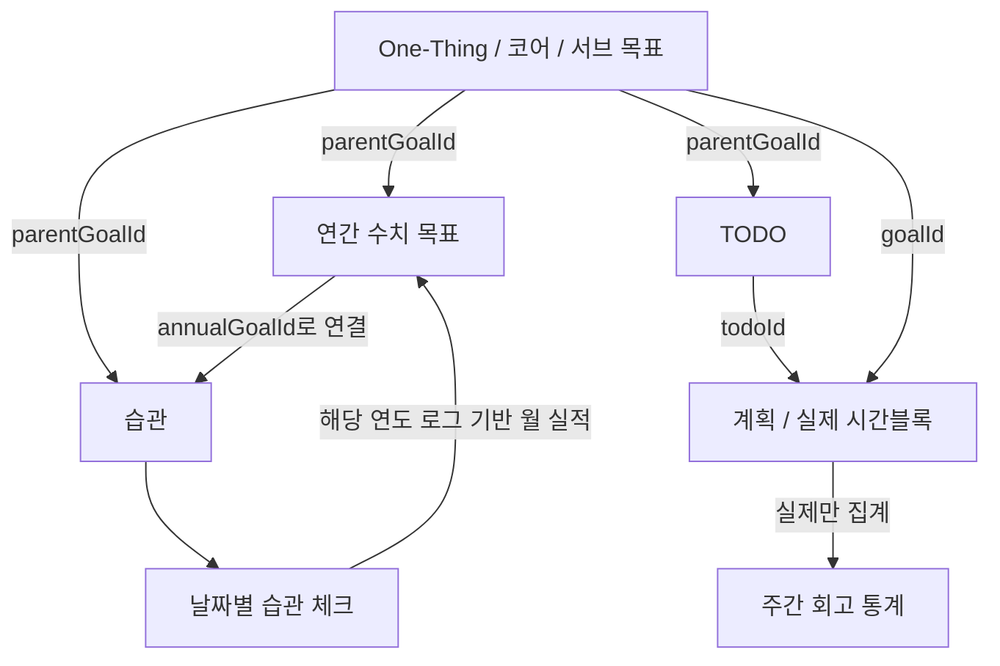

# 프로젝트 문서 목차

작성 기준: **2026-10-29 작업 트리**. 기존 미커밋 변경, TODO 중복 생성 수정과 전체 계층 리팩토링을 포함합니다. 최신 추가 기능·보안·자동 백업·CI는 [후속 개선 기록](09-follow-up-improvements.md)에 있습니다. 1차 변경 범위·검증과 2026-10-29 Docker 배포 결과는 [전체 리팩토링 기록](08-full-refactor.md)에 있습니다. 1차 소스·문서 대조 결과는 [점검 기록](07-source-doc-audit.md), 이후 수정 방법은 [유지보수 가이드](06-maintenance.md)를 확인합니다. 실제 검증·배포 내역은 [검증과 구현 한계](05-verification-and-limitations.md)에 기록합니다. 과거 구현 플랜 대신 현재 동작을 설명하는 문서입니다.

## 1. 프로젝트가 하는 일

Super 플래너는 큰 목표와 매일의 실행 기록을 함께 관리합니다. One-Thing 보드에서 방향을 정하고, 연간 목표에 수치를 기록하고, 월·주·일 TODO와 습관을 실행합니다. 주간 시간표에서는 계획과 실제 시간을 구분하며, 회고에서 실제 기록을 돌아봅니다.

모든 화면이 동일한 SQLite DB를 사용합니다. 다만 연간 목표, TODO, 습관, 시간블록은 **서로 다른 데이터**입니다. 상위 계획을 만들었다고 하위 일정이 자동 생성되지는 않습니다. 명시적인 연결과 자동 집계의 범위는 [데이터 모델](02-data-model.md)에 설명합니다.

## 2. 읽는 순서

1. 아래 화면 목록으로 프로젝트 범위를 파악합니다.
2. 페이지 문서에서 기능, 입력·저장 방식, 다른 화면과의 연결을 읽습니다.
3. [구조와 공통 구현](01-architecture.md)으로 코드의 역할을 이해합니다.
4. [데이터 모델](02-data-model.md)과 [API 명세](03-api.md)로 저장 과정을 따라갑니다.
5. 실행·배포는 [개발과 운영](04-development-and-operations.md), 현재 제약은 [검증과 구현 한계](05-verification-and-limitations.md)를 확인합니다.

## 3. 전체 화면 목록

| URL | 목적 | 상세 문서 |
|---|---|---|
| `/` | 오늘 일자 `/daily/...`로 이동 | [로그인·공통 이동](pages/01-login-and-navigation.md) |
| `/login` | 아이디·비밀번호 로그인 | [로그인·공통 이동](pages/01-login-and-navigation.md) |
| `/mandalart` | One-Thing → 코어 → 서브 목표, 자유노트 | [One-Thing 보드](pages/02-mandalart.md) |
| `/annual/[year]` | 연간 목표와 12개월 계획·실적 | [연간 계획](pages/03-annual.md) |
| `/monthly/[yyyymm]` | 월 TODO, 날짜별 TODO 달력, 습관 달력 | [월간 계획](pages/04-monthly.md) |
| `/week/[isoweek]` | 계획·실제 시간표, 일/주 TODO, 습관 | [주간 계획](pages/05-weekly.md) |
| `/daily` | 오늘 `/daily/YYYY-MM-DD`로 이동 | [일일 트래커](pages/06-daily.md) |
| `/daily/[date]` | 하루 계획·실제 기록 편집, 루틴, TODO, 메모, 독서, 회고 | [일일 트래커](pages/06-daily.md) |
| `/retrospective/week/[isoweek]` | 주간 실적 요약과 회고 작성 | [회고](pages/07-retrospective.md) |
| `/reading` | 연도별 책 목록, 완독일, 서평 | [독서](pages/08-reading.md) |
| `/search` | 전체 검색, 범위 선택, 관련 화면 이동 | [후속 개선](09-follow-up-improvements.md) |
| `/settings` | 계정, 카테고리, 표시 설정, JSON 백업 | [설정](pages/09-settings.md) |

URL 예: `/annual/2026`, `/monthly/2026-09`, `/week/2026-W37`, `/daily/2026-09-07`. 로그인 후 `/`는 오늘의 `/daily/YYYY-MM-DD`로 이동합니다. 독서는 `?year=YYYY`로 초기 연도를 지정할 수 있고 이후 선택은 화면 내부 상태입니다. 일일 기록은 일일 화면에 인라인으로 표시되고, 주간 화면의 일일 회고는 시트로 열립니다.

## 4. 데이터가 연결되는 예

일일 독서에서 책 목록의 책을 선택할 수 있지만, 쪽수가 완독 여부나 연간 독서 실적으로 자동 반영되지는 않습니다.

## 5. 문서의 범위

- 페이지 문서는 사용자 동작과 구현 파일을 함께 설명합니다.
- API 문서는 현재 핸들러를 기준으로 하며, 런타임 검증이 없는 항목을 검증된 계약처럼 설명하지 않습니다.
- 구현 한계 문서는 확인된 코드 특성입니다. 기능 추가 플랜이 아닙니다.
- 예전 `docs/superpowers/plans/`의 구현 플랜 2개와 `specs/`의 디자인 초안 1개를 제거했습니다.
- [기존 운영 기록](RUNBOOK.md)은 당시 서버 환경·장애 대응 이력을 남긴 자료입니다. 현재 사용 방법은 새 운영 문서를 우선합니다.
- 기존 설치 안내와 `Study/`의 구조 안내는 새 문서로 연결하는 안내로 통합했습니다.

[프로젝트 README](../README.md)
